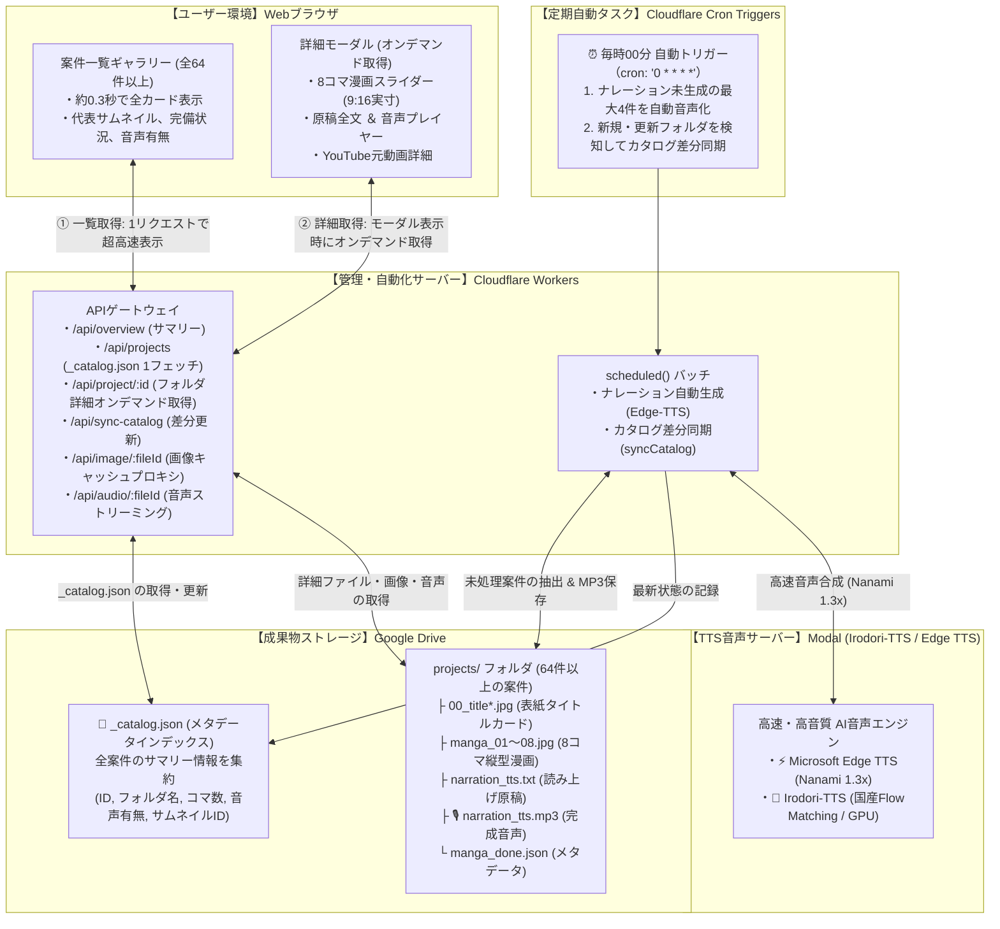

# YouTube ナレーター ＆ 漫画生成 管理ダッシュボード

Google Drive 内の `yt-narrator` フォルダ（YouTube自動要約・ナレーション・8コマ漫画生成パイプライン）に蓄積されている成果物や進捗状況を、ブラウザ上でリアルタイムに一元管理・可視化できる **Cloudflare サーバーレス管理ダッシュボード ＆ 定期自動ナレーション生成システム** です。

Cloudflare Workers と静的アセット配信（Assets）、Google Drive メタデータインデックス（`_catalog.json`）、および **Cron Triggers（毎時定期実行）** を採用しており、**サーバー代完全無料（0円）** かつ爆速（一覧表示約0.3秒・全64件以上対応）・セキュアに24時間365日常時稼働します。

---

## 🌐 ツールの接続先・クイックアクセス

| 項目 | 接続先URL | 説明 |
| :--- | :--- | :--- |
| **🎬 管理ダッシュボード（本番公開版）** | **[https://yt-narrator-dashboard.eiichi-okamine.workers.dev](https://yt-narrator-dashboard.eiichi-okamine.workers.dev)** | ブラウザから今すぐ利用できる本番Web管理画面 |
| **🐙 GitHub リポジトリ** | **[https://github.com/ohapee/yt-narrator-dashboard](https://github.com/ohapee/yt-narrator-dashboard)** | ソースコードおよび最新ドキュメント |
| **📁 対象Google Driveフォルダ (ルート)** | **[yt-narrator (Google Drive)](https://drive.google.com/drive/folders/1Q2EneDppL5P92Efk8BU5onQD4O8c9SS3)** | 管理対象の元データフォルダ |
| **📂 案件フォルダ (projects)** | **[projects (Google Drive)](https://drive.google.com/drive/folders/19qNS_wUoFOzDy646-ssSC0Y0nU34YhMf)** | ナレーション自動生成の巡回対象フォルダ |
| **💻 ローカル開発プレビュー** | `http://localhost:8787` | PC手元でのローカル開発時URL |

---

## 🏗️ システム連携図（メタデータインデックス ＆ オンデマンド取得）



---

## 🌟 主な機能

### 1. ⚡ Google Drive メタデータインデックス（50件制限の撤廃 ＆ 超高速一覧表示）
- **課題の解決**:
  - 従来は一覧画面を開くたびに全フォルダに対して数十回の Google Drive API 通信を並列実行していたため、通信制限やタイムアウトにより「50件程度しか取得できない」「読み込みに十数秒かかる」という問題がありました。
- **改善されたアーキテクチャ**:
  - Google Drive の `projects` 直下に軽量メタデータインデックス（`_catalog.json`）を自動生成・配置。
  - 一覧画面（`/api/projects`）は **たった1回のファイル取得（約0.3秒）** で全64件以上のプロジェクト一覧を瞬時にブラウザへ返却します。
- **2段階読み込み（オンデマンド取得）**:
  - 一覧画面ではカードの基本情報（案件名、更新日時、コマ数、音声有無、代表サムネイルID）のみを軽量に表示。
  - 8コマの全画像や原稿全文、YouTube詳細などの重いデータは、**カードをクリックしてモーダルを開いたとき（`/api/project/:id`）に初めてオンデマンドで取得**するため、無駄な通信が一切発生しません。
- **即時差分同期**:
  - ヘッダーの **「⚡ カタログ同期」** ボタンをクリックすると、Google Drive 内の新規追加フォルダや更新フォルダを数秒で自動検出し、`_catalog.json` を最新状態に同期します。

### 2. ⏰ 1時間毎の自動ナレーション生成バッチ ＆ カタログ自動同期
- **定期実行スケジュール**: `0 * * * *`（毎時00分に自動起動）
- **対象フォルダ**: Google Drive `projects` フォルダ (`https://drive.google.com/drive/folders/19qNS_wUoFOzDy646-ssSC0Y0nU34YhMf`)
- **処理対象**: フォルダ内に `narration_tts.txt` が存在し、`narration_tts.mp3` が未生成の案件フォルダ（古い順に最大4件/時）
- **音声スペック**:
  - 音声エンジン: Microsoft Edge-TTS
  - 話者名: `ja-JP-NanamiNeural` (Nanami・女性アナウンス)
  - 発話速度: `1.3x` (テンポのよい1.3倍速)
- **保存先**: 各案件フォルダ直下に `narration_tts.mp3` として直接アップロード保存
- **手動実行・テスト機能**:
  - 管理ダッシュボード上に設置された **「⚡ 今すぐ4件を手動実行」** ボタンをクリックするか、API (`POST /api/cron/process-narration`) を叩くだけで、1時間を待たずに即座に4件のナレーション生成＆Drive保存を実行可能。

### 3. 🎙️ ナレーション音声登録状況の可視化 ＆ インライン再生
- **概要カード集計**:
  - ダッシュボード最上部に「🎙️ 音声登録済み (MP3)」カードを追加。Google Drive上に `narration_tts.mp3` が生成完了している案件数をリアルタイムにカウント表示。
- **案件カード・サムネイルバッジ**:
  - 各案件カード上に **「🎙️ 音声あり (MP3)」** または **「⏳ 音声未生成」** のバッジを表示。サムネイル上にも「🎙️ MP3」タグを付与し、一目で音声の有無を判別可能。
- **ステータス絞り込みフィルター**:
  - フィルターメニューから「🎙️ 音声あり (MP3生成済み)」または「⏳ 音声未生成 (MP3なし)」を選択して、対象案件をワンクリックで絞り込み可能。
- **モーダル内 Google Drive 音声ストリーミング再生 ＆ ダウンロード**:
  - 案件詳細モーダルの「ナレーション原稿 ＆ 音声」タブ内に、Google Driveに保存された完成音声（`narration_tts.mp3`）のオーディオプレイヤーを常設。
  - Cloudflare Workers のストリーミングプロキシ（`/api/audio/:fileId`）により、ブラウザ上でそのまま即座に再生・ダウンロード保存が可能。

### 4. 8コマ漫画ビューア（9:16 スマホ実寸スライダー）
- 案件をクリックするとモーダルが起動し、1〜8コマ目の縦型漫画（1080×1920px）を左右矢印キーやボタン、サムネイルクリックでスムーズにパラパラ閲覧可能。

### 5. 表紙・タイトルカード一覧
- 自動生成された複数のタイトルカードバリエーション（`00_title_final.jpg` 等）を一覧表示し、拡大確認可能。

### 6. ナレーション原稿ビューア ＆ 文字数・尺計算
- 読み上げ原稿（`narration_tts.txt`）の全文表示、文字数カウント、音声読み上げ時の推定所要時間（1分350文字換算）を自動計算。ワンクリックコピーにも対応。

### 7. 🎙️ 音声合成（TTS）プレビュー（Irodori-TTS ＆ Edge TTS 両対応）
- **🌸 国産AI Irodori-TTS（Flow Matching / NVIDIA T4 GPU）**:
  - 豊かな感情表現と自然な人間らしさを兼ね備えた最新国産モデル。11種類の話者を自由に選択可能。
- **⚡ Microsoft Edge TTS（超高速・安定アナウンス・完全無料）**:
  - 7種類の上質な日本語話者から選択可能。全文を一気に聴きたい場合に最適。
- **再生速度調整 ＆ MP3保存**:
  - 0.9x〜1.5xの速度調整に対応。生成音声はワンクリックでPCに保存可能。

### 8. 📺 ナレーション作成元 YouTube 動画情報（youtube.json）の可視化
- 各プロジェクト内に自動記録された作成元YouTube動画データ（`youtube.json`）を詳細モーダル上でリッチに表示。
- サムネイル、動画タイトル、チャンネル名、公開日、動画尺、再生回数を確認可能。

---

## 🎙️ ナレーション音声の一括バッチ生成（ローカル実行ツール）

Cloudflare Workers の制限（実行時間・subrequest制限・毎時最大4件制限）にとらわれず、PCローカル環境から Google Drive 内の未生成案件を一括で高速音声化・自動アップロードできるバッチツールを提供しています。

### 特徴
- **高速エンジン**: ローカルの `edge-tts`（Microsoft Edge TTS）を直接呼び出し、1件あたり約3〜15秒で高品質な MP3 を生成。
- **自動保存 ＆ カタログ同期**: 生成した MP3（`narration_tts.mp3`）を各 Google Drive フォルダに直接保存し、完了後に `_catalog.json` を自動同期してダッシュボードに即座に反映。
- **安心設計**: いつでも中断・再開可能（生成済み案件は自動スキップ）。

### 実行方法

最も簡単な方法は、プロジェクトルートで以下のシェルスクリプトを実行することです：

```bash
cd /home/eiichi/src/yt-narrator-dashboard

# 1. デフォルト設定（Nanami / 1.5倍速 / ピッチ-10Hz）で未生成の全件を一括生成
./scripts/run_batch_narration.sh

# 2. 件数を指定してテスト実行（例: 5件のみ生成）
./scripts/run_batch_narration.sh --limit 5

# 3. 実行前の対象確認（ドライラン・ファイル生成なし）
./scripts/run_batch_narration.sh --dry-run
```

### パラメータのカスタマイズ（Python スクリプト直接実行）

話者（ボイス）、速度、音の高さを自由に指定できます：

```bash
/home/eiichi/src/python-tools/.venv/bin/python \
  scripts/batch_generate_narration.py \
  --voice ja-JP-NanamiNeural \
  --rate +50% \
  --pitch -10Hz
```

| オプション | デフォルト値 | 説明 | 指定例 |
| :--- | :--- | :--- | :--- |
| `--voice` | `ja-JP-NanamiNeural` | 話者ボイス | `ja-JP-NanamiNeural`（女性）<br>`ja-JP-KeitaNeural`（男性） |
| `--rate` | `+50%` | 発話速度 | `+0%` (等倍), `+30%` (1.3倍速), `+50%` (1.5倍速) |
| `--pitch` | `-10Hz` | 音の高さ (ピッチ) | `+0Hz` (標準), `-10Hz` (落ち着いたトーン), `+10Hz` (明るいトーン) |
| `--limit` | (なし・全件) | 処理件数の上限 | `--limit 10` (10件だけ生成) |
| `--dry-run` | `false` | 事前確認モード | 実際の生成やアップロードを行わず対象一覧を表示 |

---

## 🛠️ API エンドポイント一覧

| メソッド | パス | 説明 | パラメータ例 |
| :--- | :--- | :--- | :--- |
| `GET` | `/api/overview` | 全体の統計サマリーとキュー状況を取得（カタログ連携） | - |
| `GET` | `/api/projects` | プロジェクト一覧をメタデータインデックスから超高速取得（約0.3秒） | - |
| `POST` / `GET` | `/api/sync-catalog` | **【新機能】Google Drive の新規・更新フォルダを差分スキャンしてカタログを同期** | - |
| `GET` | `/api/project/:id` | 単一プロジェクトの詳細（ファイル・画像・原稿）をオンデマンド取得 | - |
| `GET` | `/api/image/:id` | Google Drive の画像ファイルをキャッシュプロキシ配信 | - |
| `GET` | `/api/audio/:id` | Google Drive の音声ファイルをストリーミングプロキシ配信 | - |
| `GET` | `/api/queues` | `yt-links` のキューファイル一覧と内容を取得 | - |
| `POST` | `/api/tts` | プレビュー用音声合成（Irodori / Edge）を実行しBase64返却 | `{"text":"...","engine":"edge","speed":1.3}` |
| `POST` | `/api/cron/process-narration` | ナレーション自動生成バッチを手動実行（最大N件） | `?count=4` |
| `GET` | `/api/cron/status` | 直近のCron実行状況と結果サマリーを取得 | - |

---

## 💻 開発・デプロイ方法

### 前提条件
- Node.js 18+
- Wrangler CLI (`npm install -g wrangler` または `npx wrangler`)
- Cloudflare アカウント

### 1. 依存関係のインストール
```bash
cd /home/eiichi/src/yt-narrator-dashboard
npm install
```

### 2. ローカル開発プレビュー
```bash
npx wrangler dev
```
ブラウザで `http://localhost:8787` を開くとローカルで確認できます。

### 3. Cloudflare 本番デプロイ
```bash
npx wrangler deploy
```
デプロイが完了すると、Cron Triggers (`0 * * * *`) が自動的に登録され、毎時00分の定期実行が開始されます。
