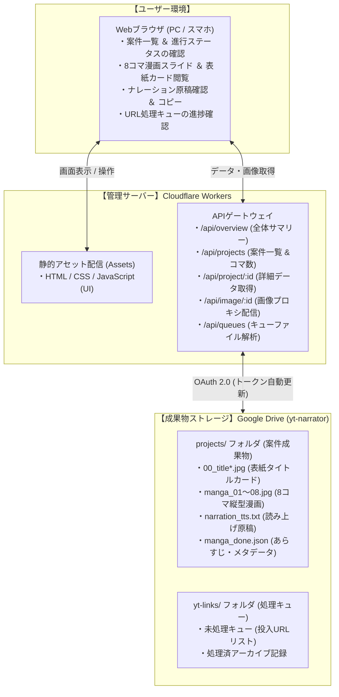

# YouTube ナレーター ＆ 漫画生成 管理ダッシュボード

Google Drive 内の `yt-narrator` フォルダ（YouTube自動要約・ナレーション・8コマ漫画生成パイプライン）に蓄積されている成果物や進捗状況を、ブラウザ上でリアルタイムに一元管理・可視化できる **Cloudflare サーバーレス管理ダッシュボード** です。

Cloudflare Workers と静的アセット配信（Assets）を採用しており、**サーバー代完全無料（0円）** かつ高速・セキュアに常時稼働します。

---

## 🌐 ツールの接続先・クイックアクセス

| 項目 | 接続先URL | 説明 |
| :--- | :--- | :--- |
| **🎬 管理ダッシュボード（本番公開版）** | **[https://yt-narrator-dashboard.eiichi-okamine.workers.dev](https://yt-narrator-dashboard.eiichi-okamine.workers.dev)** | ブラウザから今すぐ利用できる本番Web管理画面 |
| **🐙 GitHub リポジトリ** | **[https://github.com/ohapee/yt-narrator-dashboard](https://github.com/ohapee/yt-narrator-dashboard)** | ソースコードおよび最新ドキュメント |
| **📁 対象Google Driveフォルダ** | **[yt-narrator (Google Drive)](https://drive.google.com/drive/folders/1Q2EneDppL5P92Efk8BU5onQD4O8c9SS3)** | 管理対象の元データフォルダ |
| **💻 ローカル開発プレビュー** | `http://localhost:8787` | PC手元でのローカル開発時URL |

---

## 🏗️ 各サーバーの連携図（システム構成）



### 通信フローと特徴
1. **Google OAuth 2.0 自動更新**:  
   Cloudflare Workers 内部でリフレッシュトークンを用いて有効期限付きアクセストークンを自動取得・キャッシュします。
2. **高画質画像プロキシ配信**:  
   Google Drive 内の縦型漫画画像やタイトルカード画像を、Cloudflare Workers が直接ブラウザ向けに安全にプロキシ配信（HTTPキャッシュ付き）するため、ログイン認証なしでサクサク閲覧できます。
3. **サーバー代完全0円**:  
   待機費用やサーバー維持費は一切かからず、完全無料で運用できます。

---

## 🌟 主な機能

1. **フォルダ内容・生成状況の一目把握（ダッシュボード）**
   - 総プロジェクト数（全48件以上）、8コマ漫画・原稿完備件数、生成中件数をリアルタイム集計。
   - 処理キュー（`yt-links`）の最新状態や未処理件数を一目で確認可能。
2. **案件・成果物カードギャラリー**
   - 生成されたタイトルカード（表紙）または第1コマ目をアイキャッチサムネイルとして表示。
   - 漫画コマ数（例: `漫画 8コマ`、`表紙あり`）、原稿の有無、更新日時をカード形式で一覧化。
3. **8コマ漫画ビューア（9:16 スマホ実寸スライダー）**
   - 案件をクリックするとモーダルが起動し、1〜8コマ目の縦型漫画（1080×1920px）を左右矢印キーやボタン、サムネイルクリックでスムーズにパラパラ閲覧可能。
4. **表紙・タイトルカード一覧**
   - 自動生成された複数のタイトルカードバリエーション（`00_title_final.jpg` 等）を一覧表示し、拡大確認可能。
5. **ナレーション原稿ビューア ＆ 文字数・尺計算**
   - 読み上げ原稿（`narration_tts.txt`）の全文表示、文字数カウント、音声読み上げ時の推定所要時間（1分350文字換算）を自動計算。ワンクリックコピーにも対応。
6. **インクリメンタル検索 ＆ 絞り込み**
   - 案件名、チャンネル名、キーワードでの即時検索、ステータス別（完備のみ／生成中のみ）の絞り込み、並び順変更に対応。
7. **URL処理キュー（yt-links）履歴ビューア**
   - 処理待ちのYouTubeリンクや、過去の処理済みアーカイブ内容を一覧確認可能。

---

## 収録ファイル一覧

| ファイル名 / フォルダ | 役割・概要 |
| :--- | :--- |
| `src/index.js` | Cloudflare Workers API バックエンド（Google Drive API中継・画像プロキシ・トークン管理） |
| `public/index.html` | メイン画面（サマリー表示、ギャラリー、漫画スライダー、原稿ビューア） |
| `public/style.css` | 直感的で美しい日本語UIスタイルシート（レスポンシブ対応） |
| `public/app.js` | クライアント側データフェッチ、絞り込み、スライダー操作スクリプト |
| `wrangler.json` | Cloudflare Workers & Assets 設定ファイル |
| `package.json` | プロジェクト定義およびデプロイスクリプト |
| `.env.example` | 環境変数の設定サンプル |
| `.dev.vars` | ローカル開発用シークレットファイル（Git除外） |

---

## パソコン（ローカル）での起動手順

手元のパソコン上で動作を確認したい場合の手順です。

### 手順1: フォルダへ移動
```bash
cd ~/src/yt-narrator-dashboard
```

### 手順2: 依存パッケージのインストール
```bash
npm install
```

### 手順3: 開発サーバーの起動
```bash
npm start
```
起動後、ブラウザで **`http://localhost:8787`** を開くとダッシュボードが表示されます。

---

## Cloudflare へのデプロイ手順

コードやUIを修正した後、本番環境へ反映する手順です。

```bash
npm run deploy
```
コマンドを実行すると、約10秒で世界中のCloudflareエッジネットワークへ最新版が即座に反映されます。

---

## 注意点とセキュリティ

- **認証情報の保護**  
  Google OAuth のクライアントID、クライアントシークレット、リフレッシュトークンはすべて Cloudflare Workers の暗号化シークレット（`npx wrangler secret put`）として安全に保管されており、ブラウザ側やGitリポジトリには一切露出しません。
- **Google Drive API のクォータ**  
  画像やファイルのリクエスト結果は適切なキャッシュヘッダーを付与して配信されるため、APIの制限を消費しにくい安全な設計となっています。
