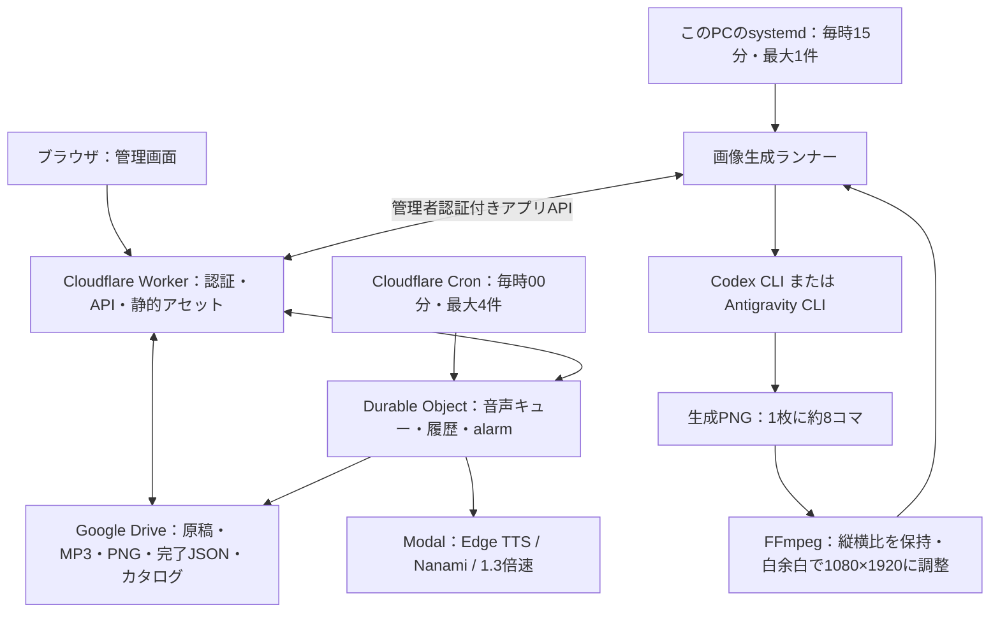

# YouTube ナレーター・漫画／インフォグラフィック管理ダッシュボード

Google Driveに保存されたYouTube動画由来の原稿・音声・画像を閲覧し、ナレーション音声と漫画／図解の生成を運用するアプリケーションです。管理画面と音声ジョブはCloudflare Workers、画像生成はログイン済みCLIを使うローカルPCで実行します。

新しい画像形式は **1枚のPNGに約8コマまたは8項目を配置した、1080×1920px・9:16の縦型画像**です。漫画／図解とタイトル画像は、同じGoogle Driveファイルを共用します。

## HTMLヘルプ・構成図

[構成図付きのHTML説明書](public/help.html)を用意しています。管理画面の「ヘルプ・構成図」、ログイン画面、公開動画の管理画面、動画ライブラリから参照できます。ブラウザでは `/help.html` を開いてください。Cloudflare・Drive・PC・Modal・R2の関係、3つの生成フロー、自動実行の時間、再生速度・公開／非公開の操作、保存形式、再試行とFAQをまとめています。図はHTML内のSVGで、外部ライブラリ不要・印刷／PDF保存にも対応します。

ローカル管理画面： http://localhost:8787/help.html ／ 動画の試作環境： http://localhost:8792/help.html 。[本番ヘルプ](https://yt-narrator-dashboard.eiichi-okamine.workers.dev/help.html)にも反映済みです。ヘルプは設計・操作の説明で、稼働状況のリアルタイム表示ではありません。

## 接続先

| 対象 | 接続先 |
| --- | --- |
| 本番管理画面 | https://yt-narrator-dashboard.eiichi-okamine.workers.dev |
| ローカル管理画面 | http://localhost:8787 |
| GitHub | https://github.com/ohapee/yt-narrator-dashboard |

管理画面へのアクセスには管理者パスワードが必要です。Driveの管理対象は環境変数で設定します。

## 公開動画ライブラリ（2026-11-10追加）

新方式の画像と完成音声をFFmpegで **1080×1920・H.264/AACのMP4** にし、Cloudflare R2へ保存して `/watch/` から一覧・連続再生する機能を追加しました。検索、前後移動、0.5〜2倍の再生速度、繰り返し、個別共有URL、元のYouTube動画を開くリンク、スマホ用QRコード、管理者による非公開化に対応します。管理画面とDriveの原稿は公開しません。

**2026-11-11にR2の有効化を検知し、バケット作成・Workerの本番デプロイが自動で完了しました。** [公開動画ライブラリ](https://yt-narrator-dashboard.eiichi-okamine.workers.dev/watch/)から閲覧できます。PCの自動処理が15分ごとに画像・音声がそろった未公開案件を確認し、1回最大2件を動画化・アップロードして順次公開します。非公開にした案件は自動再公開しません。

```bash
npm run publish:videos -- --project DRIVE_FOLDER_ID --render-only --limit 1
npm run publish:videos -- --dry-run
# 有効化待ち／自動セットアップ／順次公開のサイクルを手動実行
npm run automate:videos -- --limit 2
# 本番R2の設定後
npm run publish:videos -- --limit 2
```

実行・保存・公開／非公開・定期化の詳細は [公開動画ライブラリの運用手順](docs/PUBLIC_VIDEO_LIBRARY.md) を参照してください。R2のバインディングは通常の `wrangler.json` に統合しており、以後の更新は `npm run deploy` で維持されます。

## 最近の変更

### 2026-11-09：YouTube Shorts用サイズへ変更

- 新規の完成画像を **1080×1920px（9:16）** に統一しました。
- CLIには1152×2048px等の9:16の構図で、見出しと約8コマを1枚に収めるよう指定します。
- 実際の生成サービスが指定外のサイズ・比率を返す場合があるため、FFmpegで縦横比を保ったサイズ調整を行い、必要な部分に白い余白を加えます。コマや文字の切り抜き・縦横比の変形はしません。
- 保存APIでも1080×1920px以外の画像を拒否します。プロンプト版は `single-page-cli-v2-shorts` です。
- 既存1案件で再生成・Drive保存・表示を検証しました。既存の全画像を自動的に一括変換したわけではありません。

### 2026-11-08：生成処理・管理機能の改善

| 対象 | 変更内容 |
| --- | --- |
| 音声の復旧 | Sec-MS-GEC v2対応のEdge TTSへ更新したModalサービスを利用。定期生成はNanami・1.3倍速 |
| 案件検索 | 先頭100フォルダの制限を解消。フォルダ・ファイル一覧をページ末尾まで探索 |
| カタログ | 子ファイル追加時に親フォルダの更新日時が変わらなくても反映。25案件ごとのファイル取得で集約 |
| 音声ジョブ | Durable Objectに永続化。重複防止、期限付き実行権、再試行、失敗案件を避けた後続処理、履歴画面 |
| 認証 | 管理者パスワード、署名付きCookie、ログイン試行制限、Drive参照・更新範囲の検査 |
| 通信 | タイムアウト・一時障害時の再試行。音声・動画のRangeリクエストに対応 |
| 画面 | 概要・一覧・キューを並列取得し、一部取得失敗でも取得できた内容を表示。引用符を含む案件名にも対応 |
| 動画編集 | 負のシーン時間を修正。画像1枚形式と従来9シーンに対応。演出・字幕付き書き出しZIP |
| 画像生成 | Codex CLIで1枚の漫画／図解を生成。タイトルは同じファイルを共用。Antigravity CLIの呼び出し経路も追加 |
| 検証 | API、ジョブ、Drive、時間配分、画像検査、実動画出力、ブラウザのテストとGitHub Actionsを追加 |

## システム構成



| 処理 | 実行場所 | スケジュール | PC停止時 |
| --- | --- | --- | --- |
| 管理画面・API | Cloudflare Workers | リクエスト時 | 本番画面は利用可能 |
| 定期ナレーション生成 | Cloudflare Cron＋Durable Object＋Modal | 毎時00分、最大4件を登録 | 本番側で継続 |
| 漫画・図解生成 | このPCのsystemd＋CLI＋FFmpeg | 毎時15分、最大1件 | 停止。PC・ユーザーサービス・CLIログインが必要 |
| ローカル画面 | `wrangler dev` | 起動中のみ | 利用不可 |

CloudflareのCron式は `0 * * * *`（UTC）ですが、毎時00分のため日本時間でも毎時00分です。systemdはホストのタイムゾーンに従います。サービスの利用枠・契約・実行量により費用や制限が変わるため、全構成が無条件に無料・無制限という前提ではありません。

このリポジトリは、YouTube動画から原稿を新規作成する元の処理やModal音声サービス本体を含みません。Driveにある原稿を入力として使い、外部のModalサービスへ接続します。

## Google Driveの成果物

```text
yt-narrator/
├── yt-links/                      # 元動画リンクのキュー（閲覧対象）
└── projects/
    ├── _catalog.json              # 全案件の一覧・集計
    └── 案件フォルダ/
        ├── narration_tts.txt      # 音声・画像生成の入力原稿
        ├── youtube.json           # 元動画情報（存在すれば表示）
        ├── narration_tts.mp3      # 完成したナレーション
        ├── visual_summary.png     # 新方式：1080×1920、1枚に約8コマ
        ├── visual_done.json       # 新方式：生成情報・入力ハッシュ・寸法
        └── video_mapping.json     # 保存した動画のシーン設定
```

従来の `manga_01.jpg`〜`manga_08.jpg`、`manga_done.json`、`00_title*.jpg`、`title_done.json` も読み取れます。旧ファイルを削除する移行処理はありません。

- 新方式の完了判定：原稿＋`visual_summary.png`等の単一画像＋`visual_done.json`。
- 従来方式の完了判定：原稿＋8枚以上の漫画画像＋`manga_done.json`。
- 音声の完了判定は画像とは独立し、原稿あり・MP3なしの案件が音声待ちです。`narration.mp3` という既存名も認識します。
- 新方式のタイトル表示とサムネイルは漫画と同じファイルIDを使います。タイトル用の別生成・コピーは行いません。
- カタログは `projects` 直下の各フォルダのファイルを再確認して更新します。GETによる閲覧ではカタログを新規作成しません。未作成の場合は同期が必要です。

## 音声生成の流れ

1. 毎時のCronまたは画面の手動実行から、原稿がありMP3がない案件を古い順に最大4件検出します。漫画が未完成の案件も対象です。
2. 既に音声がある案件や、処理中・失敗状態の案件を除外します。失敗案件は履歴画面から明示的に再試行します。
3. 案件ID・原稿のSHA-256・エンジン・話者・速度・修正番号からジョブIDを作り、Durable Objectに登録します。手動APIはHTTP 202を返し、生成処理は応答後に継続します。
4. alarmが1件ずつ実行します。10分の実行権を保存し、途中終了したジョブはその期限後に回収できます。
5. Drive上の既存MP3と原稿ハッシュを再確認し、Modalの `/api/edge-tts` で生成、MP3を保存します。
6. 成功・失敗・再試行予定を履歴に保存し、Driveカタログへ集計を反映します。

定期生成の設定は `src/narration.js` の `NARRATION_SETTINGS` にあります。

| 設定 | 値 |
| --- | --- |
| エンジン | Microsoft Edge TTS |
| 話者 | `ja-JP-NanamiNeural` |
| 速度 | `1.3` |
| ピッチ | `0` |
| 固定した上流修正番号 | `ba61d94442c18893f0c4d3c5ad253718b21ab93e` |

Modal側では上記コミットのSec-MS-GEC v2対応を使用します。サービスの `/health` の `edgeTtsRevision`、`edgeTtsProtocol` で確認できます。Modalサービスを更新する場合は別プロジェクト側での作業が必要です。管理画面のプレビューではIrodoriも選択できますが、定期生成のエンジンはEdge TTSです。

一時障害時は最大3回のジョブ試行を行い、再試行まで1分・5分待ちます。HTTP 400/401/403/404/409/422等は恒久的な失敗として扱い、401/403ではサービス全体を15分休止します。通信にも個別のタイムアウトと短い再試行があり、ジョブ試行回数と外部HTTPリクエスト数は同じではありません。音声生成の通信タイムアウトは120秒です。

## 従来のローカル音声一括バッチ

GitHub側で追加されていた `scripts/batch_generate_narration.py` と `scripts/run_batch_narration.sh` も保持しています。これはPythonの`edge_tts`を直接利用し、Driveのカタログで音声待ちの案件を処理する別経路です。Python環境の`edge_tts`とDrive OAuth設定が必要で、シェルは既定で `/home/eiichi/src/python-tools/.venv/bin/python`、存在しなければ`python3`を使います。

```bash
# 対象確認（生成・アップロードなし）
bash scripts/run_batch_narration.sh --dry-run

# 話者・速度・ピッチと上限を明示して生成
bash scripts/run_batch_narration.sh --limit 5 \
  --voice ja-JP-NanamiNeural --rate +30% --pitch +0Hz
```

シェルを引数なしで実行した場合は、Nanami・`+50%`・`-10Hz`で件数上限なく生成します。引数を渡した場合はPython側へそのまま渡し、未指定項目はPython側の既定（速度`+30%`・ピッチ`+0Hz`）になります。

この経路はDurable Objectの実行権・履歴・再試行を共有しません。通常運用には管理画面の永続キューを使い、このバッチを併用する場合は同じ案件に対する定期音声処理との重複を避けて実行してください。Modal側のEdge TTS修正はローカルPython環境には自動反映されません。バッチ終了時のカタログ更新後は、必要に応じて画面の同期で実ファイルを再確認します。

## 漫画・インフォグラフィック生成の流れ

### CLIとモデル

| 項目 | Codex CLI | Antigravity CLI |
| --- | --- | --- |
| 実行コマンド | `codex exec` | `agy --print` |
| 標準の推論モデル | `gpt-6.1-sol` | `gemini-4-argon-medium` |
| 画像の作成 | ログイン済みアカウントの内蔵画像生成 | 内蔵image-generatorの利用を指示 |
| この環境での検証 | 生成・保存・表示まで検証済み | 呼び出し経路は実装済み、画像生成は未検証 |

`--model` は構成を考える**推論モデル**の指定です。画像モデルの指定ではありません。CLIの結果で画像モデル名が取得できないため、現在のメタデータでは `imageModel: null` とし、画面では「CLIから非公開」と表示します。推論モデルを画像モデルとして表示しません。

画像生成API・画像APIキー・APIスクリプトへのフォールバックはありません。CLIが生成できなければ失敗として記録します。CLIの認証済みアカウントとその利用枠を使用します。画像の取得・保存には通常の管理アプリAPIとGoogle Drive APIを使用します。

### 実行手順

1. ランナーが認証付きでカタログを取得します。既定では原稿がある未完了案件を、カタログの並び順（名前降順）に最大1件処理します。音声検索の古い順とは異なります。
2. 原稿を取得し、案件・原稿ハッシュ・CLI・推論モデル・画風・プロンプト版から処理の識別子を作ります。既に同じ設定で完了している案件はスキップします。
3. CLIに原稿を資料として読み込ませ、内容を約8コマ／8項目に整理し、見出し付きの1枚のPNGとして生成します。原稿中の文章を実行指示として扱わないよう指定します。
4. ネイティブ生成には9:16の構図を指定します。サイズが異なる場合も、FFmpegで全体を収め、白い余白で**1080×1920px**へ調整します。
5. PNGの存在・構造・解像度・容量（12MB以下）とFFmpegでのデコードを確認します。CLIにも内容・文字・構図の確認を指示しますが、人間による全件の品質確認を代替するものではありません。
6. アプリの保存APIが原稿ハッシュを再確認します。生成中に原稿が変わった場合はHTTP 409で保存を拒否します。
7. PNGと `visual_done.json` をDriveへ保存します。既存の同名PNGは更新し、別タイトル画像は作りません。カタログ更新は保存応答後に実行するため、一覧への反映に少し時間がかかる場合があります。

### 操作例

```bash
cd /home/eiichi/src/yt-narrator-dashboard

# 対象確認のみ（CLIのバージョン・アプリへの接続は確認するが画像は生成しない）
npm run generate:visuals -- --dry-run

# 未完了案件を1件処理
npm run generate:visuals -- --limit 1

# 指定案件を漫画として処理
npm run generate:visuals -- --project DRIVE_FOLDER_ID

# 指定案件をインフォグラフィックとして処理
npm run generate:visuals -- --style infographic --project DRIVE_FOLDER_ID

# 推論モデルを指定
npm run generate:visuals -- --model gpt-6.1-sol --project DRIVE_FOLDER_ID

# Antigravity CLI（この環境での画像生成は未検証）
npm run generate:visuals -- --provider antigravity --style infographic --project DRIVE_FOLDER_ID
```

`--limit` は1〜4です。`--project` で指定すると完了済み案件も確認対象になりますが、同じ原稿・設定・プロンプト版で完了済みなら再生成しません。旧サイズの既存画像を新方式で生成し直す場合は案件を明示して実行します。新しいプロンプト版では別の処理識別子を使います。完了済み案件全体の自動再生成は行いません。

### 保存情報と再開

`visual_done.json` には次の情報を記録します。

| 情報 | 内容 |
| --- | --- |
| `mode`, `style` | `single_page`、`comic`または`infographic` |
| `panels_count` | 構成の目標である8。画像認識による自動実測値ではありません |
| `provider`, `cliVersion` | CLI種別とバージョン |
| `reasoningModel`, `imageModel` | 指定した推論モデル、非公開の画像モデルは`null` |
| `inputHash`, `promptVersion` | 原稿SHA-256、現在は`single-page-cli-v2-shorts` |
| `width`, `height`, `aspectRatio`, `bytes` | 完成画像の寸法・比率・容量 |
| `imageFileId`, `titleImageFileId`, `titleReuse` | 共用するDrive画像のID |
| `processed_at`, `synopsis` | 保存日時、原稿冒頭の抜粋。`synopsis`は別生成した要約ではありません |

ローカルには次のように原稿・プロンプト・生成物・実行状態を残します。これらはGit対象外です。

```text
.artifacts/visuals/
├── runner.lock                    # flockが使うファイル
├── state.json                     # 実行状態・失敗・次回再試行時刻
└── 処理識別子/
    ├── source.txt
    ├── prompt.txt
    ├── generated.png              # CLIから受け取った元画像
    ├── visual_summary.png         # 検査済みの1080×1920画像
    ├── cli-output.log
    ├── cli-stderr.log
    └── result.txt                 # Codex CLIの最終応答
```

- `flock` でこのPC上の二重実行を防ぎます。別PC同士の排他制御ではありません。自動ランナーは1台で運用してください。
- 保存に失敗しても完成PNGが残っていれば、次回は画像を作り直さず検査・保存から再開します。
- 失敗案件は自動実行で6時間待ち、後続案件を処理します。`--project` を指定するとこの待機を解除して再試行します。
- 壊れたPNGがある場合は、まず該当ログとファイルを確認してください。同じファイルを再利用して失敗する場合は、当該PNGファイルを手動で退避してから再実行します。フォルダ全体の削除は不要です。
- CLIへは管理者トークンやAPIキー等の対象環境変数を渡さないようにしています。CLI用のログイン情報は各CLI側で管理します。

詳細な設計メモは [docs/IMAGE_PIPELINE_PLAN.md](docs/IMAGE_PIPELINE_PLAN.md) を参照してください。

## 動画シーン編集と書き出し

- 新方式の画像1枚は、ナレーションの全尺を受け持つ1シーンになります。既定のカメラ演出は`none`です。
- 従来の形式は表紙1枚＋漫画8枚の計9シーンです。
- 均等割りと原稿文字数に応じた配分は0.1秒単位の整数で計算し、負のシーン時間や合計尺の丸めずれを防ぎます。
- シーンごとの開始・終了時刻、画像／動画クリップ、ズーム・パン・フェード、字幕を編集し、`video_mapping.json` に保存できます。保存APIは1シーンまたは9シーンのみ受け付け、案件内の素材と連続した正の時間を検査します。
- 「書き出しセット（ZIP）」に素材・音声・描画用スクリプト・必要に応じたSRT字幕を含めます。これは完成MP4をブラウザ内で直接生成する機能ではありません。

ZIPを展開した場所で、FFmpegと日本語フォントがある環境から実行します。

```bash
bash render.sh
```

素材を1080×1920px・30fpsに統一し、設定した演出と字幕を反映した `output.mp4` を作成します。字幕の描画にはlibass対応のFFmpegと日本語フォントが必要です。

## 認証と設定

### 管理者パスワード

このPCの管理者パスワードは次のファイルにあります。ファイル内容はGitHubへ保存しません。

```text
/home/eiichi/src/yt-narrator-dashboard/.admin-password
```

ブラウザではこのパスワードでログインします。APIと画像ランナーも同じ `ADMIN_TOKEN` を使用します。署名付きのHttpOnly・SameSite=Strict Cookieで12時間のセッションを作成し、HTTPSではSecure属性を付けます。パスワード認証の失敗は接続元ごとに15分間で5回に制限します。

パスワードを変更する場合は、ローカルの `.admin-password`、`.dev.vars` の `ADMIN_TOKEN`、本番Workerの `ADMIN_TOKEN` を同じ値に更新します。本番への登録は次の対話コマンドで行い、パスワードをコマンド引数や公開ファイルに書かないでください。

```bash
npx wrangler secret put ADMIN_TOKEN
```

変更すると既存セッションは無効になります。CLIランナーは環境変数 `ADMIN_TOKEN` があればそれを優先し、未設定なら `.admin-password` を読みます。`.admin-password` と `.dev.vars` は所有者のみ読み書き可能な権限で管理します。

### 環境変数

| 変数 | 用途 | 設定場所 |
| --- | --- | --- |
| `GOOGLE_CLIENT_ID` | Drive OAuthクライアントID | ローカル`.dev.vars`／本番Worker secret |
| `GOOGLE_CLIENT_SECRET` | OAuthクライアントシークレット | 同上 |
| `GOOGLE_REFRESH_TOKEN` | 管理対象へアクセスできるOAuthリフレッシュトークン | 同上 |
| `TARGET_FOLDER_ID` | `yt-narrator`ルートのDriveフォルダID | 同上 |
| `PROJECTS_FOLDER_ID` | 任意。設定すれば`projects`の検索を省略 | 同上 |
| `ADMIN_TOKEN` | 管理画面・API共通の管理者パスワード | 同上。CLIでは環境変数または`.admin-password` |
| `MODAL_TTS_URL` | 任意。Modal音声サービスのベースURL | ローカル`.dev.vars`／本番Worker設定 |
| `JOB_COORDINATOR_URL` | 任意。ローカルから本番音声キューを利用するURL | **ローカル`.dev.vars`のみ** |
| `DASHBOARD_URL` | CLIランナーの接続先。既定は本番管理画面 | CLI／systemdプロセスの環境変数 |

Wranglerはローカルで `.dev.vars` を読み込みます。`.env.example` は設定項目の見本です。画像ランナーは `.dev.vars` を自動では読み込みません。

ローカルと本番で音声の二重登録を防ぐため、現在のPCでは次を `.dev.vars` に設定しています。

```dotenv
JOB_COORDINATOR_URL=https://yt-narrator-dashboard.eiichi-okamine.workers.dev/api/job-coordinator
```

この設定時はローカル画面の操作も本番音声キューへ反映されます。本番Workerには設定しないでください。設定しないローカル環境では、ローカルDurable Objectの別キューを利用します。同じDriveへ接続する複数キューを同時に動かさないようにします。

管理APIは認証と同一オリジンの操作確認を行い、Driveの対象外フォルダ・素材への操作を拒否します。画像・音声・動画も認証付きのAPI経由で取得し、音声・動画はRange再生に対応します。

## 開発・デプロイ

### 前提条件

- Node.js 22、npm。
- CloudflareアカウントとWranglerの認証。
- 管理対象へアクセスできるGoogle Drive OAuth設定。
- 音声生成用の稼働済みModalサービス。
- 画像生成にはLinuxの`flock`、FFmpeg、ログイン済みのCodex CLI（または利用可能な`agy`）。
- 画像の定期生成にはユーザーsystemd。動画の字幕書き出しには日本語フォント。

### ローカル起動

```bash
npm ci
if [ ! -e .dev.vars ]; then cp .env.example .dev.vars; fi
# .dev.varsを編集し、必要な値を設定する
chmod 600 .dev.vars
npm run dev
```

既に `.dev.vars` がある環境では上書きせず、そのファイルを編集してください。http://localhost:8787 を開き、`ADMIN_TOKEN` の値でログインします。CLIランナーを使う場合は同じ値の `.admin-password` を別途用意するか、プロセスへ `ADMIN_TOKEN` を設定します。

カタログがない場合は、ログイン後に「カタログ同期」を実行します。`wrangler dev` では毎時のCloudflare Cronは自動起動しません。

### 本番へデプロイ

初回はGoogle OAuthの3項目、`TARGET_FOLDER_ID`、`ADMIN_TOKEN` を `npx wrangler secret put 変数名` で登録します。その後、次を実行します。

```bash
npm run deploy
```

`wrangler.json` に静的アセット、毎時Cron、`JOBS` Durable Objectバインディング、`v1-jobs`マイグレーションを定義しています。既存のマイグレーション履歴は維持してください。デプロイだけではPC側の画像ランナーは起動しません。

## 画像の定期実行（systemd）

設定ファイルは `ops/systemd/` にあります。サンプルは現在のPCの絶対パスを使用するため、他環境では `WorkingDirectory`、`ExecStart`、CLIへの`PATH`を修正してください。標準設定はCodex・漫画形式・最大1件、サービス上限30分です。CLI自体は約21分で打ち切ります。

```bash
mkdir -p ~/.config/systemd/user
cp ops/systemd/yt-narrator-visuals.service ~/.config/systemd/user/
cp ops/systemd/yt-narrator-visuals.timer ~/.config/systemd/user/
systemctl --user daemon-reload
systemctl --user enable --now yt-narrator-visuals.timer

# 次回予定・直近ログ
systemctl --user list-timers yt-narrator-visuals.timer
journalctl --user -u yt-narrator-visuals.service -n 50

# 定期実行を待たずに1回実行
systemctl --user start yt-narrator-visuals.service

# 定期実行を停止
systemctl --user disable --now yt-narrator-visuals.timer
```

`Persistent=true`のため、ユーザータイマーが再起動した際に実行漏れ分を1回補う場合があります。停止時間の件数分を一括生成する設定ではありません。ユーザーサービスがログアウト後も稼働するかはホストの設定に依存します。

## API一覧

認証にはログインCookieまたは `Authorization: Bearer <ADMIN_TOKEN>` を使用します。`/api/auth/status`、ログイン・ログアウトは認証状態を管理するための例外です。

| メソッド | パス | 処理 |
| --- | --- | --- |
| GET | `/api/auth/status` | ログイン状態 |
| POST | `/api/auth/login` | JSONの`password`でログイン |
| POST | `/api/auth/logout` | Cookieの失効 |
| GET | `/api/overview` | 全体集計・パイプライン状態・キュー概要 |
| GET | `/api/pipeline-status` | 画像・タイトル・音声の完了／停滞状態 |
| GET | `/api/projects` | カタログの全案件 |
| POST | `/api/sync-catalog` | Drive再確認・カタログ更新 |
| GET | `/api/project/:id` | 全ページの素材一覧・原稿・画像・生成情報 |
| POST | `/api/project/:id/video-mapping` | 1シーンまたは9シーンの動画設定を保存 |
| GET / HEAD | `/api/image/:id` | 認証付き画像取得 |
| GET / HEAD | `/api/audio/:id` | MP3取得・Range再生 |
| GET / HEAD | `/api/video/:id` | 動画クリップ取得・Range再生 |
| GET | `/api/queues` | Driveの元動画リンクキューを閲覧 |
| POST | `/api/tts` | Edge／Irodoriのプレビュー音声を生成 |
| POST | `/api/cron/process-narration?count=4` | 最大1〜4件を音声キューへ登録しHTTP 202を返す |
| GET | `/api/cron/status` | 永続音声キューの状態・履歴 |
| GET | `/api/jobs` | 永続音声キューの状態・履歴 |
| POST | `/api/jobs/retry` | JSONの`id`で音声ジョブを再試行 |
| POST | `/api/visuals/:projectId` | CLIの完成PNGを検査して保存。画像生成自体は行わない |

`/api/job-coordinator/*` はローカルから本番キューを共有する内部接続用です。Bearer認証を要求し、通常の画面操作には `/api/jobs` 等を使用します。

## 困ったとき

| 症状 | 確認・対処 |
| --- | --- |
| ログインできない | `.admin-password`、ローカル／本番の`ADMIN_TOKEN`が一致しているか確認。429なら15分待って再試行 |
| カタログがない／画像が一覧に出ない | 画面の「カタログ同期」。保存直後は非同期同期の完了を待つ |
| 音声が止まった | 履歴のエラーと状態、最後の成功日時、認証休止、Cloudflareログ、Modalの`/health`と`/api/edge-tts`を確認 |
| 音声がローカルで自動生成されない | 自動Cronは本番のみ。手動実行または本番側のCron設定を確認 |
| 画像が自動生成されない | PC・ユーザーサービス・timerの稼働、CLIログイン、利用枠、FFmpeg、管理アプリへの接続を確認 |
| 画像生成が失敗した | `journalctl`、`.artifacts/visuals/state.json`、対象処理のCLIログを確認。`--project`で指定して再試行 |
| アップロードが失敗した | 完成PNGがあれば再試行で再利用。原稿が変わった409なら、新しい原稿の識別子で生成し直す |
| 旧画像が2:3のまま | 完了済みは自動再生成しない。必要な案件を`--project`で指定。更新後も最大5分の画像キャッシュが残る場合あり |
| タイトル画像が別に作られない | 新方式は漫画と同じファイルを共用する仕様 |
| 画像モデル名が出ない | CLI結果からモデル名が得られないため。表示される推論モデルとは別の情報 |
| 一部パネルの日本語・内容が不正確 | 自動生成のため公開前に確認。必要に応じて画像・プロンプトを確認して再生成 |
| 動画の字幕が表示されない | 字幕有効設定、libass対応FFmpeg、日本語フォントを確認 |

## テストとファイル構成

```bash
npm test
npx playwright install chromium
npm run test:browser
```

ローカルで既存Chromiumを使う場合は `PLAYWRIGHT_CHROMIUM_EXECUTABLE_PATH=/path/to/chrome npm run test:browser` で指定できます。GitHub ActionsはNode.js 22、FFmpeg、日本語フォント、Chromiumを用意して同じテストを実行します。2026-11-09の検証は自動テスト25件・ブラウザテスト2件が成功しています。CIは実サービスの認証や有料の画像生成を呼ばず、APIモックとローカル素材で検証します。

| パス | 役割 |
| --- | --- |
| `src/index.js` | Workerルーティング、パイプライン状態、Cron |
| `src/auth.js` | 管理者認証、Cookie、操作元・リクエストサイズ確認 |
| `src/drive.js`, `src/catalog.js` | Drive接続、範囲検査、ページング、カタログ |
| `src/jobs.js`, `src/job-client.js`, `src/narration.js` | 永続音声キュー、実行・再試行、ローカル／本番接続 |
| `src/visuals.js` | 画像検査、1080×1920の保存制約、メタデータ |
| `src/http.js`, `src/media.js`, `src/validation.js` | 通信・素材配信・動画設定検査 |
| `scripts/generate-visuals.mjs` | ローカルCLI画像生成、サイズ調整、検査、保存、再開 |
| `public/` | 管理画面、認証、履歴、動画書き出し |
| `ops/systemd/` | 画像生成のサービス・タイマー |
| `tests/`, `playwright.config.js` | 自動テスト・ブラウザテスト |
| `.github/workflows/test.yml` | GitHub Actions |
| `docs/IMAGE_PIPELINE_PLAN.md` | 画像方式の設計・運用メモ |

`scripts/build_catalog.cjs` は従来の手動スクリプトです。通常運用のカタログ更新には、ページング等を改善したWorkerの同期API／画面を使用してください。

`.dev.vars`、`.env`、`.admin-password`、`.artifacts/`、`.wrangler/`、ブラウザ検証の成果物はGit対象外です。原稿・画像・実行ログ・認証情報は公開リポジトリへ含めません。
