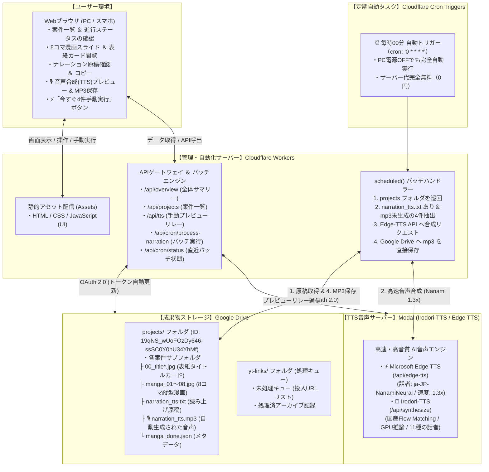

# YouTube ナレーター ＆ 漫画生成 管理ダッシュボード

Google Drive 内の `yt-narrator` フォルダ（YouTube自動要約・ナレーション・8コマ漫画生成パイプライン）に蓄積されている成果物や進捗状況を、ブラウザ上でリアルタイムに一元管理・可視化できる **Cloudflare サーバーレス管理ダッシュボード ＆ 定期自動ナレーション生成システム** です。

Cloudflare Workers と静的アセット配信（Assets）、および **Cron Triggers（毎時定期実行）** を採用しており、**サーバー代完全無料（0円）** かつ高速・セキュアに24時間365日常時稼働します。

---

## 🌐 ツールの接続先・クイックアクセス

| 項目 | 接続先URL | 説明 |
| :--- | :--- | :--- |
| **🎬 管理ダッシュボード（本番公開版）** | **[https://yt-narrator-dashboard.eiichi-okamine.workers.dev](https://yt-narrator-dashboard.eiichi-okamine.workers.dev)** | ブラウザから今すぐ利用できる本番Web管理画面 |
| **🐙 GitHub リポジトリ** | **[https://github.com/ohapee/yt-narrator-dashboard](https://github.com/ohapee/yt-narrator-dashboard)** | ソースコードおよび最新ドキュメント |
| **📁 対象Google Driveフォルダ (ルート)** | **[yt-narrator (Google Drive)](https://drive.google.com/drive/folders/1Q2EneDppL5P92Efk8BU5onQD4O8c9SS3)** | 管理対象の元データフォルダ |
| **📂 案件フォルダ (projects)** | **[projects (Google Drive)](https://drive.google.com/drive/folders/19qNS_wUoFOzDy646-ssSC0Y0nU34YhMf)** | ナレーション自動生成の巡回対象フォルダ |
| **💻 ローカル開発プレビュー** | `http://localhost:8787` | PC手元でのローカル開発時URL |

---

## 🏗️ 各サーバーの連携図（システム構成）



### 通信フローと特徴
1. **1時間毎の自動ナレーション生成（Cloudflare Cron）**:  
   Cloudflare Workers のエッジネットワークが毎時00分に自動起動し、Google Drive 内の `projects` フォルダを巡回。未処理フォルダを最大4件抽出し、Edge-TTS で音声を生成して各フォルダへ直接 `narration_tts.mp3` をアップロードします。
2. **重複生成の完全防止（安全設計）**:  
   既に `narration_tts.mp3` が存在するフォルダは自動でスキップされるため、無駄な再生成やAPIの重複呼び出しは一切発生しません。
3. **Google OAuth 2.0 自動更新**:  
   Cloudflare Workers 内部でリフレッシュトークンを用いて有効期限付きアクセストークンを自動取得・キャッシュします。
4. **高画質画像プロキシ配信**:  
   Google Drive 内の縦型漫画画像やタイトルカード画像を、Cloudflare Workers が直接ブラウザ向けに安全にプロキシ配信（HTTPキャッシュ付き）するため、ログイン認証なしでサクサク閲覧できます。
5. **国産AI「Irodori-TTS」＆「Edge TTS」ハイブリッド連携**:  
   ナレーション原稿をその場で最新国産モデル **Irodori-TTS（高表現力・NVIDIA T4 GPU）** または **Edge TTS（超高速・アナウンス向け）** の声色で試聴可能。ブラウザ即時プレビュー（待機0秒）とワンクリックMP3保存にも対応しています。
6. **サーバー代完全0円**:  
   待機費用やサーバー維持費は一切かからず、完全無料で運用できます。

---

## 🌟 主な機能

### 1. ⏰ 1時間毎の自動ナレーション生成バッチ（新機能！）
- **定期実行スケジュール**: `0 * * * *`（毎時00分に自動起動）
- **対象フォルダ**: Google Drive `projects` フォルダ (`https://drive.google.com/drive/folders/19qNS_wUoFOzDy646-ssSC0Y0nU34YhMf`)
- **処理対象**: フォルダ内に `narration_tts.txt` が存在し、`narration_tts.mp3` が未生成の案件フォルダ（古い順に最大4件/時）
- **音声スペック**:
  - 音声エンジン: Microsoft Edge-TTS
  - 話者名: `ja-JP-NanamiNeural` (Nanami・女性アナウンス)
  - 発話速度: `1.3x` (テンポのよい1.3倍速)
- **保存先**: 各案件フォルダ直下に `narration_tts.mp3` として直接アップロード保存
- **手動実行・テスト機能**:
  - 管理ダッシュボード上に設置された **「⚡ 今すぐ4件を手動実行」** ボタンをクリックするか、API (`POST /api/cron/process-narration`) を叩くだけで、1時間を待たずに即座に4件のナレーション生成＆Drive保存を実行可能。

### 2. フォルダ内容・生成状況の一目把握（ダッシュボード）
- 総プロジェクト数（全48件以上）、8コマ漫画・原稿完備件数、生成中件数をリアルタイム集計。
- 処理キュー（`yt-links`）の最新状態や未処理件数を一目で確認可能。

### 3. 案件・成果物カードギャラリー
- 生成されたタイトルカード（表紙）または第1コマ目をアイキャッチサムネイルとして表示。
- 漫画コマ数（例: `漫画 8コマ`、`表紙あり`）、原稿の有無、更新日時をカード形式で一覧化。

### 4. 8コマ漫画ビューア（9:16 スマホ実寸スライダー）
- 案件をクリックするとモーダルが起動し、1〜8コマ目の縦型漫画（1080×1920px）を左右矢印キーやボタン、サムネイルクリックでスムーズにパラパラ閲覧可能。

### 5. 表紙・タイトルカード一覧
- 自動生成された複数のタイトルカードバリエーション（`00_title_final.jpg` 等）を一覧表示し、拡大確認可能。

### 6. ナレーション原稿ビューア ＆ 文字数・尺計算
- 読み上げ原稿（`narration_tts.txt`）の全文表示、文字数カウント、音声読み上げ時の推定所要時間（1分350文字換算）を自動計算。ワンクリックコピーにも対応。

### 7. 🎙️ 音声合成（TTS）プレビュー ＆ MP3ダウンロード保存（Irodori-TTS ＆ Edge TTS 両対応）
- **🌸 国産AI Irodori-TTS（Flow Matching / NVIDIA T4 GPU）**:
  - 豊かな感情表現と自然な人間らしさを兼ね備えた最新国産モデル。11種類の話者を自由に選択可能。
- **⚡ Microsoft Edge TTS（超高速・安定アナウンス・完全無料）**:
  - 7種類の上質な日本語話者から選択可能。全文を一気に聴きたい場合に最適。
- **再生速度調整 ＆ MP3保存**:
  - 0.9x〜1.5xの速度調整に対応。生成音声はワンクリックで `[案件名]_[エンジン名]_tts.mp3` としてPCに保存可能。

### 8. 📺 ナレーション作成元 YouTube 動画情報（youtube.json）の可視化
- 各プロジェクト内に自動記録された作成元YouTube動画データ（`youtube.json`）を詳細モーダル上でリッチに表示。
- サムネイル、動画タイトル、チャンネル名、公開日、動画尺、再生回数を確認可能。

---

## 🛠️ API エンドポイント一覧

| メソッド | パス | 説明 | パラメータ例 |
| :--- | :--- | :--- | :--- |
| `GET` | `/api/overview` | 全体の統計サマリーとキュー状況を取得 | - |
| `GET` | `/api/projects` | プロジェクト一覧・メタデータを取得 | `?limit=50` |
| `GET` | `/api/project/:id` | 単一プロジェクトの詳細（ファイル一覧）を取得 | - |
| `GET` | `/api/image/:id` | Google Drive の画像ファイルをキャッシュプロキシ配信 | - |
| `GET` | `/api/queues` | `yt-links` のキューファイル一覧と内容を取得 | - |
| `POST` | `/api/tts` | プレビュー用音声合成（Irodori / Edge）を実行しBase64返却 | `{"text":"...","engine":"edge","speed":1.3}` |
| **`POST`** | **`/api/cron/process-narration`** | **【新機能】ナレーション自動生成バッチを手動実行（最大N件）** | `?count=4` |
| **`GET`** | **`/api/cron/status`** | **【新機能】直近のCron実行状況と結果サマリーを取得** | - |

---

## 💻 開発・デプロイ方法

### 前提条件
- Node.js 18+
- Wrangler CLI (`npm install -g wrangler` または `npx wrangler`)
- Cloudflare アカウント

### 1. 依存関係のインストール
```bash
cd /home/eiichi/src/yt-narrator-dashboard
npm install
```

### 2. ローカル開発プレビュー
```bash
npx wrangler dev
```
ブラウザで `http://localhost:8787` を開くとローカルで確認できます。

### 3. Cloudflare 本番デプロイ
```bash
npx wrangler deploy
```
デプロイが完了すると、Cron Triggers (`0 * * * *`) が自動的に登録され、毎時00分の定期実行が開始されます。
